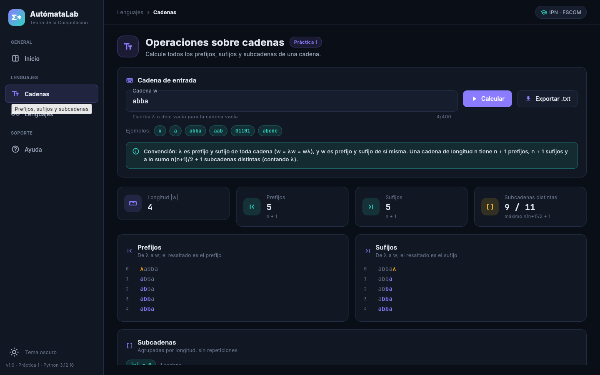

# AutómataLab — Software interactivo de Teoría de la Computación


| | |
|---|---|
| **Institución** | Instituto Politécnico Nacional — Escuela Superior de Cómputo |
| **Unidad de aprendizaje** | Teoría de la Computación |
| **Carrera** | Ingeniería en Sistemas Computacionales (Plan 2020) |
| **Nombre completo** | _(escriba su nombre)_ |
| **Número de boleta** | _(escriba su boleta)_ |
| **Grupo** | _(escriba su grupo)_ |
| **Profesor** | _(escriba el nombre del profesor)_ |
| **Fecha de entrega** | Práctica 1: martes 22 de septiembre de 2026 |

Un único software, construido de forma acumulativa a lo largo de las prácticas, para estudiar
cadenas, lenguajes y autómatas finitos con una interfaz gráfica en **Python + Flet**.



## Índice

### Práctica 1 — Operaciones básicas sobre lenguajes

| Documento | Contenido |
|---|---|
| [01-entorno.md](docs/practica1/01-entorno.md) | Repositorio, Docker, tres versiones de Python |
| [02-investigacion.md](docs/practica1/02-investigacion.md) | Investigación (a cargo del alumno) |
| [03-estado-del-arte.md](docs/practica1/03-estado-del-arte.md) | Cinco artículos (a cargo del alumno) |
| [04-jflap.md](docs/practica1/04-jflap.md) | Autómatas en JFLAP |
| [05-aplicacion.md](docs/practica1/05-aplicacion.md) | Aplicación, convenciones, pruebas y resultados |
| [conclusiones.md](docs/practica1/conclusiones.md) | Conclusiones |
| [bibliografia.md](docs/practica1/bibliografia.md) | Bibliografía |

## Funcionalidades

| Módulo | Práctica | Qué hace |
|---|---|---|
| Inicio | 1 | Panel con indicadores, accesos rápidos y actividad reciente |
| Cadenas | 1 | Prefijos, sufijos y subcadenas; conteos y exportación a `.txt` |
| Lenguajes | 1 | Σ*, Σ⁺ y Σⁿ con límite de 200 000 cadenas; operaciones entre lenguajes finitos |
| Ayuda | 1 | Convenciones matemáticas y guía de uso |

Tema oscuro (predeterminado) y claro; el menú lateral se compacta en pantallas estrechas.

## Estructura del repositorio

```
README.md  .gitignore  .gitattributes  requirements.txt  pytest.ini
.github/workflows/pruebas.yml   integración continua (3.11, 3.12, 3.13)
entorno/Dockerfile  entorno/compose.yml
src/
  app.py                 punto de entrada
  core/lenguajes.py      núcleo: funciones puras, sin Flet
  ui/                    interfaz (tema, estado, componentes, páginas)
  assets/fonts/          tipografías incluidas (SIL OFL)
tests/                   pruebas con pytest
docs/practica1/          reporte de la Práctica 1
automatas/               archivos .jff
evidencias/practica1/    git/ docker/ jflap/ app/
```

## Cómo ejecutar

### Con contenedores (Docker Desktop)

Desde la carpeta `entorno/`:

```bash
docker compose build                              # construye las tres imágenes
docker compose run --rm py311 python --version    # Python 3.11.x
docker compose run --rm py312 python --version    # Python 3.12.x
docker compose run --rm py313 python --version    # Python 3.13.x
docker compose run --rm py311 pytest -q           # pruebas en cada versión
docker compose run --rm py312 pytest -q
docker compose run --rm py313 pytest -q
docker compose up py312                           # interfaz en http://localhost:8550
docker compose down                               # apaga y limpia
```

Si usa Podman, los comandos son los mismos sustituyendo `docker` por `podman`.

### En su equipo

```bash
py -3.12 -m venv venv            # Windows   (macOS/Linux: python3 -m venv venv)
venv\Scripts\activate            # Windows   (macOS/Linux: source venv/bin/activate)
pip install -r requirements.txt
python src/app.py                # abre la aplicación de escritorio
pytest -q                        # ejecuta las pruebas
```

## Versiones

* **Flet 0.86.5** (`flet[web]`), **pytest 8.3.4**.
* **FastAPI fijada en 0.144.0**: `flet-web 0.86.5` usa un argumento que FastAPI eliminó en
  0.145.0; con una versión posterior el servidor web no arranca (detalle en
  [01-entorno.md](docs/practica1/01-entorno.md)).

## Convenciones

* **λ** es la cadena vacía. Se escribe `λ`, `lambda` o se deja el campo vacío.
* λ y la propia *w* se cuentan entre los prefijos y sufijos de *w*: hay *n + 1* de cada uno.
