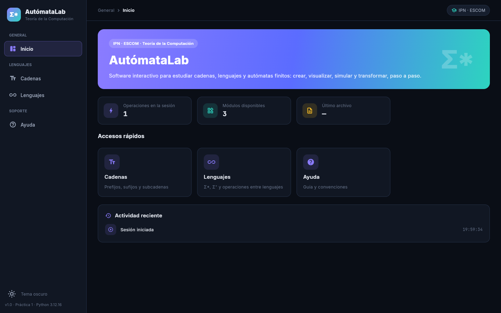
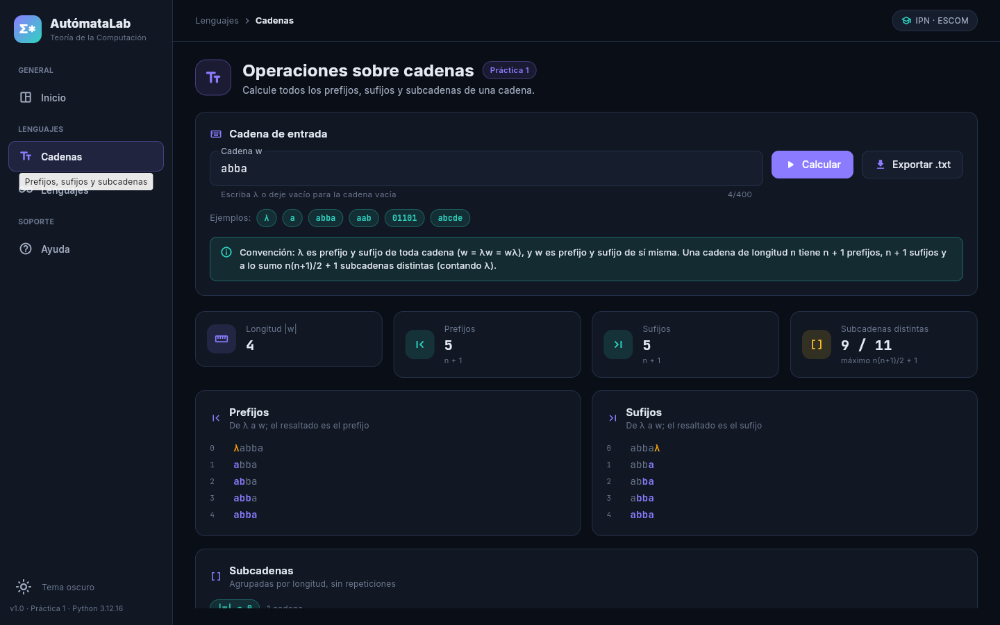
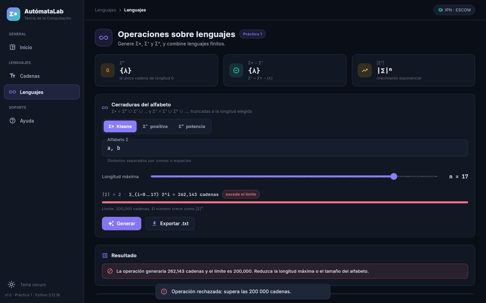
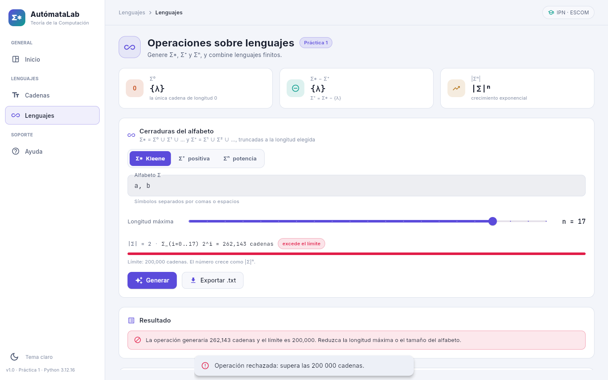

# Ejercicio 5. Aplicación con interfaz gráfica

## Estructura: núcleo separado de la interfaz

```
src/
  app.py                  punto de entrada: ft.run(main)
  core/
    lenguajes.py          funciones puras, sin dependencias de Flet
  ui/
    tema.py               paletas oscura y clara, tipografías
    estado.py             estado compartido, notificaciones, guardar/abrir archivos
    aplicacion.py         menú lateral, barra superior, registro de módulos
    componentes/comunes.py
    paginas/              inicio, cadenas, lenguajes, ayuda
  assets/fonts/           Inter y JetBrains Mono (licencia SIL OFL)
tests/
  test_lenguajes.py
```

`core/lenguajes.py` no importa nada de `ui/` ni de Flet; las pruebas lo importan directamente
(`pytest.ini` añade `src` al `pythonpath`). La interfaz sólo llama a sus funciones.

## Operación 1. Subcadenas, prefijos y sufijos

| Función | Resultado para `w = abba` |
|---|---|
| `prefijos(w)` | λ, a, ab, abb, abba |
| `sufijos(w)` | λ, a, ba, bba, abba |
| `subcadenas(w)` | λ, a, b, ab, bb, ba, abb, bba, abba |

**Convención adoptada.** La cadena vacía **sí** figura entre los prefijos y los sufijos, y la
propia `w` también. La justificación es la definición: `u` es prefijo de `w` si existe `v` con
`w = uv`; tomando `u = λ, v = w` (y `u = w, v = λ`) se ve que λ y `w` siempre lo son. Excluirlas
daría los prefijos *propios*, que el núcleo también ofrece (`prefijos_propios`, `sufijos_propios`).

**Conteos.** Una cadena de longitud `n` tiene exactamente **n + 1 prefijos** (uno por cada punto
de corte `0..n`) y **n + 1 sufijos**. Para cada longitud `k = 1..n` hay `n − k + 1` posiciones,
así que el número de subcadenas distintas es a lo sumo

```
1 + Σ_{k=1}^{n} (n − k + 1) = n(n + 1)/2 + 1
```

contando λ. La cota se alcanza sólo si todos los símbolos son distintos (`abcd` → 11); con
repeticiones hay menos (`abba` → 9, `aaaa` → 5). La pantalla muestra ambos números.

La interfaz resalta cada prefijo y sufijo dentro de la cadena completa, agrupa las subcadenas por
longitud y exporta los tres resultados a un `.txt` (una cadena por línea, λ escrita como `λ`).

## Operación 2. Cerradura de Kleene y cerradura positiva

* `potencia_alfabeto(Σ, n)` = Σⁿ; `Σ⁰ = {λ}` porque λ es la única cadena de longitud 0.
* `cerradura_kleene(Σ, n)` = Σ⁰ ∪ … ∪ Σⁿ (contiene λ).
* `cerradura_positiva(Σ, n)` = Σ¹ ∪ … ∪ Σⁿ (no contiene λ); por eso `Σ* − Σ⁺ = {λ}`, y con
  longitud máxima 0 se obtiene `Σ* = {λ}` y `Σ⁺ = ∅`.

### El límite de 200 000 cadenas

Σ* y Σ⁺ son infinitos; el programa los trunca a la longitud máxima `n`. El número de cadenas es

```
|Σ⁰ ∪ … ∪ Σⁿ| = Σ_{i=0}^{n} |Σ|ⁱ = (|Σ|ⁿ⁺¹ − 1)/(|Σ| − 1)     (|Σ| > 1)
```

que crece exponencialmente con `n`. Antes de generar nada, `contar_cerradura` evalúa la suma y,
si supera 200 000, se lanza `LimiteExcedido` con la cantidad exacta. Así el rechazo es inmediato y
no consume memoria. Ejemplo: con Σ = {0, 1}, `n = 16` produce 131 071 cadenas y se acepta;
`n = 17` produciría 262 143 y se rechaza. La pantalla muestra la fórmula y una barra con la
proporción respecto del límite mientras el usuario mueve el control de longitud.

La relación con la unidad: la cerradura de Kleene es un conjunto infinito numerable; lo que una
computadora puede enumerar es sólo un prefijo finito de ese conjunto en orden canónico, y su
tamaño depende exponencialmente de la longitud.

### Operaciones entre lenguajes finitos

Como en la aplicación de referencia del Anexo 1, la pantalla incluye concatenación, unión,
intersección, diferencia, potencia `Lⁿ` (con `L⁰ = {λ}`) y reflexión de lenguajes finitos.

## Pruebas automatizadas

[`tests/test_lenguajes.py`](../../tests/test_lenguajes.py) — 45 pruebas. Cubre lo solicitado:

| Requisito | Pruebas |
|---|---|
| Cadena vacía | `test_prefijos_de_la_cadena_vacia`, `test_sufijos_de_la_cadena_vacia`, `test_subcadenas_de_la_cadena_vacia` |
| Alfabeto de un solo símbolo | `test_kleene_de_alfabeto_unario`, `test_positiva_de_alfabeto_unario` |
| Prefijos y sufijos de longitud 1 | `test_prefijos_y_sufijos_de_longitud_uno`, `test_subcadenas_de_longitud_uno` |
| Σ* frente a Σ⁺ en longitud 0 | `test_kleene_longitud_cero_es_lambda`, `test_positiva_longitud_cero_es_vacia`, `test_sigma_cero_es_lambda` |
| Límite de 200 000 | `test_se_rechaza_mas_de_doscientas_mil_cadenas`, `test_limite_exacto_se_acepta` |

## Ejecución en los tres entornos

Salida real en [`evidencias/practica1/docker/pytest.txt`](../../evidencias/practica1/docker/pytest.txt):

| Servicio | Versión | `pytest -q` |
|---|---|---|
| py311 | 3.11.18 | 45 passed |
| py312 | 3.12.16 | 45 passed |
| py313 | 3.13.18 | 45 passed |

No se observaron diferencias de comportamiento entre versiones. La integración continua de
GitHub Actions ejecuta la misma suite con las tres versiones en cada *push* y Pull Request.

## Interfaz servida desde el contenedor

`docker compose up py312` y abrir http://localhost:8550. Capturas tomadas desde el contenedor:

| | |
|---|---|
| Panel de inicio |  |
| Cadenas |  |
| Rechazo por límite |  |
| Tema claro |  |

En el navegador, «Exportar» descarga el archivo; en escritorio (`python src/app.py`) abre el
diálogo de guardado.
