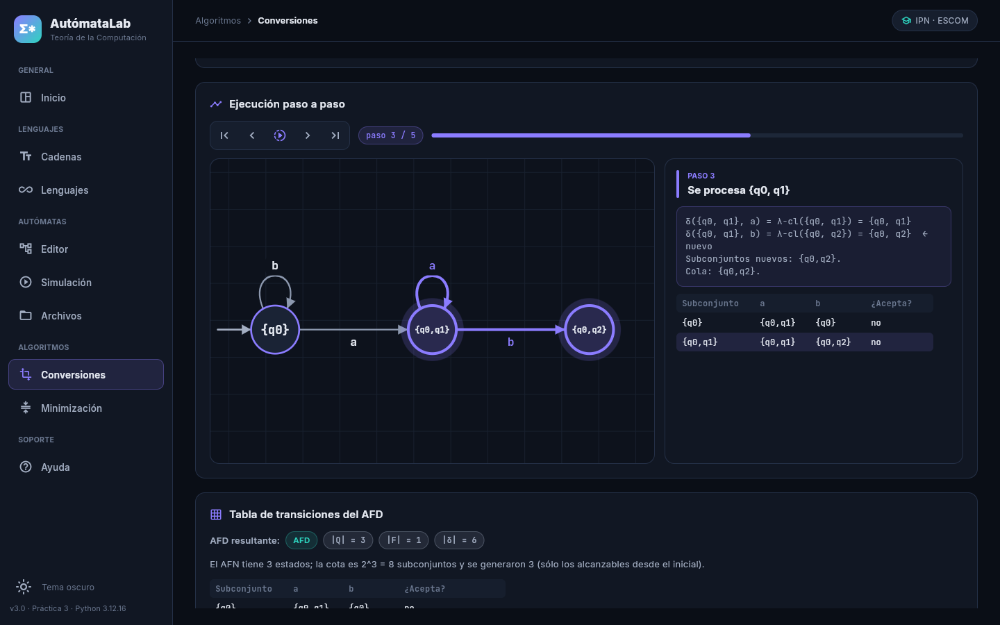
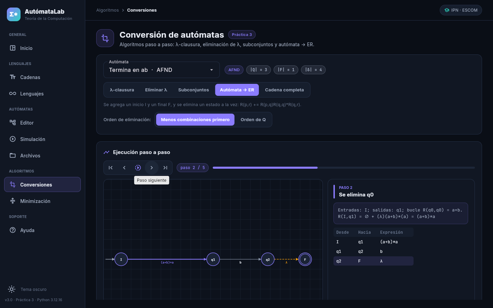
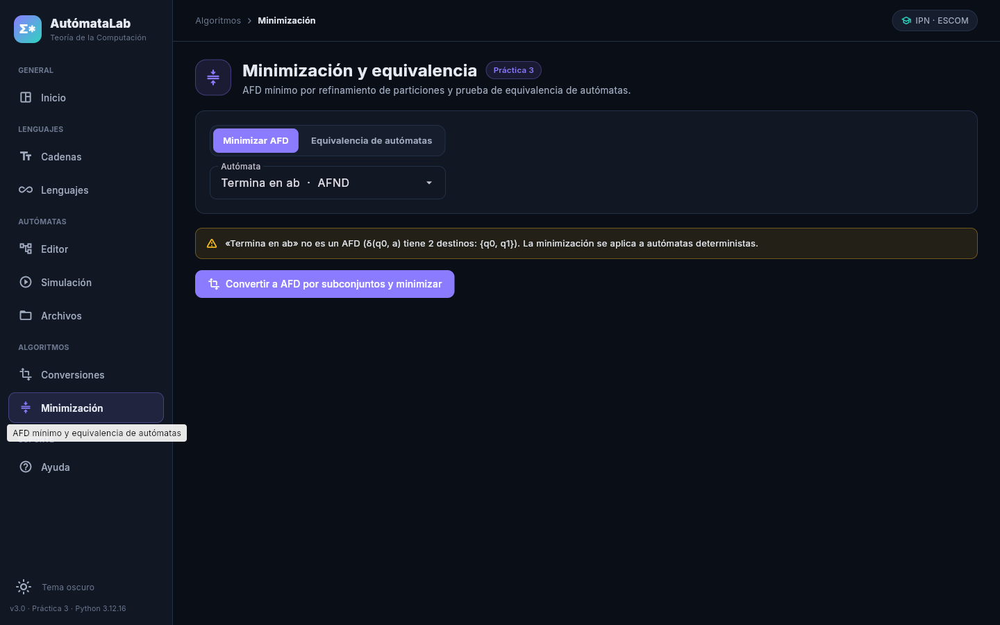
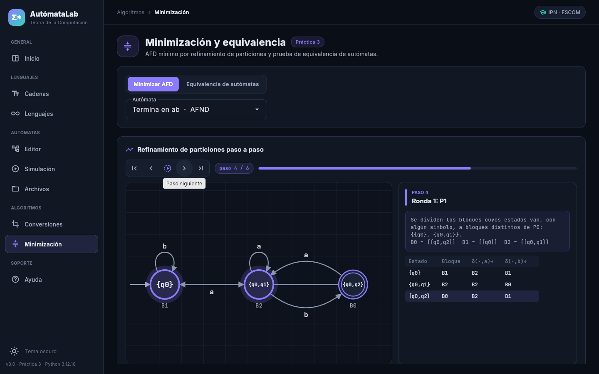
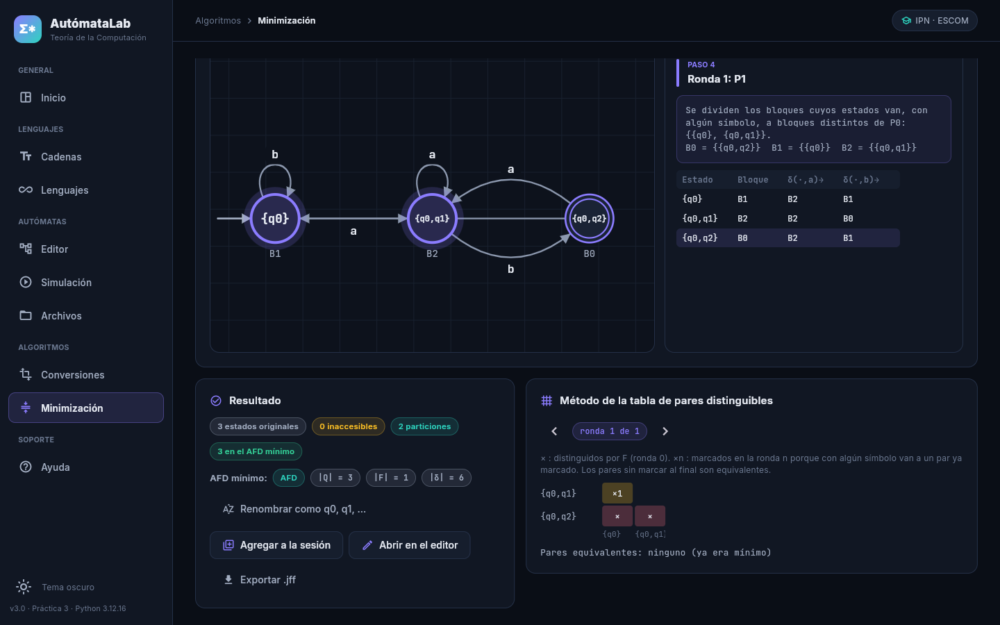

# Ejercicio 2. Extensión del software interactivo

Todo algoritmo se ejecuta sobre el autómata seleccionado en la sesión, que puede venir del editor o de
un `.jff` importado en *Archivos*. Cada algoritmo se muestra **paso a paso** con el reproductor común
([`ui/componentes/reproductor.py`](../../src/ui/componentes/reproductor.py)): diagrama con estados y
aristas resaltados, explicación del paso y su tabla; se avanza, retrocede o reproduce.

| Requisito | Dónde | Implementación |
|---|---|---|
| 2.1 λ-clausura de cada estado y de uno elegido | *Conversiones → λ-clausura* | `algoritmos/cerradura.py` |
| 2.1 Simulación directa de AFN-λ con activos antes/después de la clausura | *Simulación* («Tras leer (antes de λ-cl.)» y «Después de la λ-clausura») | `core/simulacion.py` (desde la Práctica 2) |
| 2.2 Eliminación de λ con transiciones agregadas y nuevos estados de aceptación | *Conversiones → Eliminar λ* | `algoritmos/eliminacion_lambda.py` |
| 2.3 Subconjuntos alcanzables con la tabla conforme se genera y los de aceptación | *Conversiones → Subconjuntos* | `algoritmos/subconjuntos.py` |
| 2.4 Inaccesibles, particiones por ronda y AFD mínimo | *Minimización → Minimizar AFD* | `algoritmos/minimizacion.py` |
| 2.4 Tabla de pares distinguibles por ronda | *Minimización* (panel inferior) | `minimizacion.tabla_distinguibles` |
| 2.4 Equivalencia de dos AFD | *Minimización → Equivalencia* | `algoritmos/equivalencia.py` |
| 2.5 Validación de un `.txt` y guardado del informe | *Simulación → Varias cadenas* | `simulacion.leer_lineas`, `validar_lote`, `informe_lote` |
| 2.6 Pruebas | `tests/test_algoritmos.py`, `tests/test_eliminacion_estados.py` | ver [03-algoritmos.md](03-algoritmos.md#pruebas-26) |
| Adicional: AFD → ER y cadena completa AFN-λ → AFD mínimo | *Conversiones* | `algoritmos/eliminacion_estados.py` |

Si el autómata elegido para minimizar no es determinista, el software lo indica con el estado y el
símbolo que lo impiden y ofrece convertirlo primero por subconjuntos.

## Casos de prueba

Los casos de la Lista 3 (151-157, 191-194, 196-200 y 260-263) corresponden al alumno. Basta con guardar
sus `.jff` en [`automatas/practica3/casos-de-prueba/`](../../automatas/practica3/casos-de-prueba/): las
pruebas automatizadas los recorren todos. Hoy la carpeta contiene seis casos propios (AFND-λ, AFND y un
AFD con estados equivalentes e inaccesibles).

## Resultados de las pruebas

[`evidencias/practica3/docker/pytest.txt`](../../evidencias/practica3/docker/pytest.txt) (salida real):

| Servicio | Versión | `pytest -q` |
|---|---|---|
| py311 | 3.11.18 | 278 passed |
| py312 | 3.12.16 | 278 passed |
| py313 | 3.13.18 | 278 passed |

La integración continua ejecuta la misma suite con las tres versiones.

## Capturas (aplicación servida desde el contenedor)

| | |
|---|---|
| Subconjuntos, paso 3: se procesa {q0,q1} y aparece {q0,q2} |  |
| Autómata → ER: se elimina q0 con su bucle a+b |  |
| Minimización de un AFND: se pide convertir primero |  |
| Ronda de particiones con los bloques sobre el diagrama |  |
| Resultado y tabla de pares distinguibles |  |
