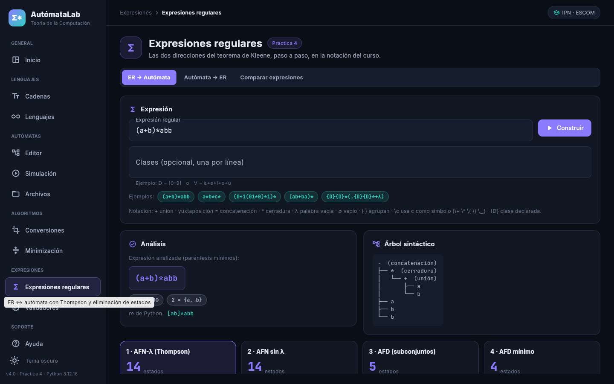
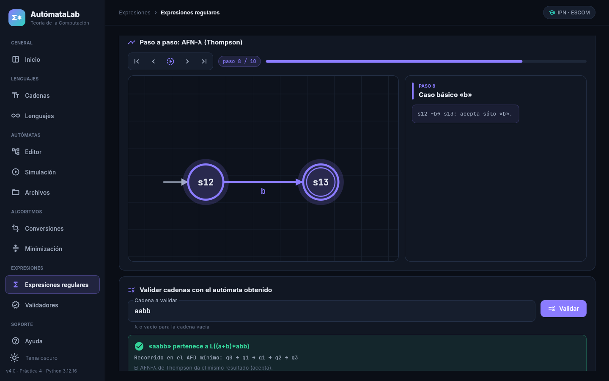
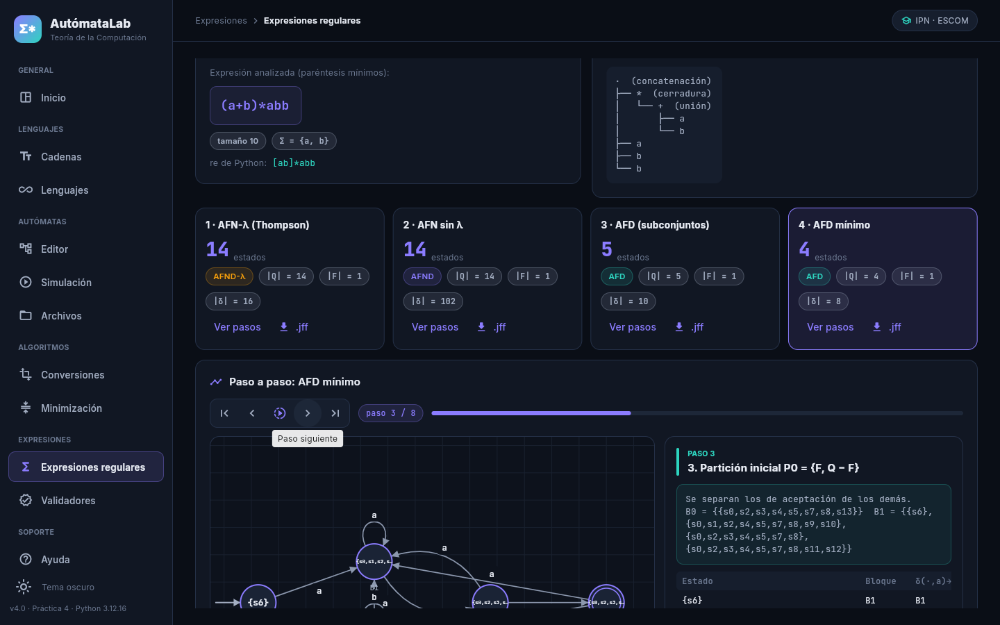

# Ejercicio 2. De expresión regular a autómata

## Notación aceptada por el analizador

| Elemento | Escritura | Ejemplo |
|---|---|---|
| Unión | `+` | `a+b` |
| Concatenación | yuxtaposición | `ab` |
| Cerradura de Kleene | `*` (posfijo, se puede repetir) | `(ab)*` |
| Palabra vacía | `λ` (también `ε`) | `a+λ` |
| Lenguaje vacío | `∅` (también `Ø`) | `a∅` |
| Agrupación | `( )` | `(a+b)*abb` |
| Símbolo que coincide con un operador | `\c` | `\+52`, `\(`, `\ ` (espacio) |
| Clase de símbolos | `{NOMBRE}` declarada aparte | `{D}{D}*` con `D = [0-9]` |

Precedencia: `*` > concatenación > `+`. Los espacios sin escapar se ignoran.

**Clases.** Se declaran una por línea como `NOMBRE = definición`, donde la definición es `[...]` con
rangos (`[a-zA-Z0-9]`, `\-` para el guion) o una unión de símbolos y de clases ya declaradas
(`V = a+e+i+o+u`, `A = {L}+{D}`). Una clase es siempre un conjunto de símbolos: equivale a la unión de
sus casos básicos.

## Análisis sintáctico

[`core/expresion_regular.py`](../../src/core/expresion_regular.py), función `analizar`: descenso
recursivo para la gramática

```
unión    → concat ( '+' concat )*
concat   → factor factor*
factor   → átomo '*'*
átomo    → símbolo | λ | ∅ | {clase} | '(' unión ')'
```

Cada nivel de la gramática es un nivel de precedencia. El árbol no se simplifica al analizar (la
construcción de Thompson trabaja sobre la estructura tal como se escribió). Una expresión mal formada se
rechaza con `ErrorSintaxis`, que indica la **posición** y la marca con `^`:

| Entrada | Posición | Mensaje |
|---|---|---|
| `a+` | 2 | Falta el operando derecho de la unión +. |
| `+a` | 1 | Falta el operando izquierdo de la unión +. |
| `*a` | 1 | La cerradura * no tiene a qué aplicarse. |
| `(a+b` | 1 | Falta cerrar el paréntesis abierto en la posición 1. |
| `a+b)` | 4 | Paréntesis de cierre ) sin su apertura. |
| `()` | 1 | Paréntesis vacíos: escriba λ si quiere la palabra vacía. |
| `{X}a` | 1 | La clase {X} no está declarada. |

## Construcción de Thompson

[`algoritmos/thompson.py`](../../src/algoritmos/thompson.py) (Thompson, 1968; Hopcroft, Motwani y
Ullman, 2007, sec. 3.2.3). Se recorre el árbol de las hojas a la raíz; cada nodo produce un fragmento
con un inicio y un final:

| Caso | Fragmento |
|---|---|
| ∅ | inicio y fin sin transiciones |
| λ | inicio –λ→ fin |
| a | inicio –a→ fin |
| {C} | inicio –c→ fin para cada c ∈ C (la unión de los casos básicos con un solo par de estados) |
| r₁+…+r_k | nuevo inicio –λ→ cada inicio; cada fin –λ→ nuevo fin |
| r₁r₂…r_k | fin de rᵢ –λ→ inicio de rᵢ₊₁ |
| r* | nuevo inicio –λ→ inicio de r y –λ→ nuevo fin; fin de r –λ→ inicio de r y –λ→ nuevo fin |

En la interfaz (*Expresiones regulares → ER → Autómata*) el primer paso muestra el **árbol sintáctico**
y cada paso siguiente el **fragmento parcial** construido, con los estados y las transiciones λ nuevos
resaltados. El AFN-λ final tiene un único estado de aceptación sin transiciones salientes y a lo sumo
2·|r| estados (lo comprueba `test_forma_del_afn_de_thompson`).

## Hasta el AFD mínimo

[`algoritmos/tuberia.py`](../../src/algoritmos/tuberia.py) aplica sin cambios los algoritmos de la
Práctica 3: eliminación de λ → subconjuntos → minimización. Al final, los estados del AFD mínimo se
renombran q0, q1, … (los nombres heredados de los subconjuntos son ilegibles) y la correspondencia queda
registrada como un paso. Cada etapa tiene *Ver pasos* y exportación a `.jff`. La cadena que escribe el
usuario se valida con el AFD mínimo, y se indica que el AFN-λ da el mismo resultado.

Ejemplo `(a+b)*abb`: AFN-λ de 14 estados → AFN de 14 → AFD de 5 → AFD mínimo de 4 estados.

## Casos de prueba

Los casos de las listas (Lista 3, 241-253; Lista 4, 272, 273 y 278) corresponden al alumno: basta con
escribirlos en la pantalla o agregarlos a la lista `EXPRESIONES` de
[`tests/test_expresiones.py`](../../tests/test_expresiones.py). Las pruebas actuales usan 19 expresiones
propias y comprueban que **todas las etapas** aceptan exactamente las cadenas de la expresión
(verificadas con derivadas de Brzozowski) hasta longitud 5 o 6.

## Capturas (aplicación servida desde el contenedor)

| | |
|---|---|
| Análisis, árbol sintáctico y etapas |  |
| Un paso de Thompson y la validación de una cadena |  |
| Minimización del AFD de la expresión |  |
